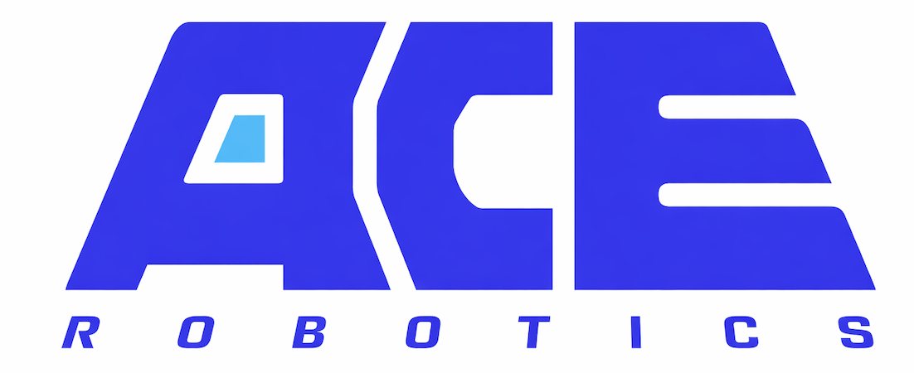

# ACE-Brain-0.6

### Scaling Spatial Grounding for Physical Foundation Models

**A 9B vision-language model for identifying what to interact with—and where.**

  
  
  
  

**9B parameters · ~1.5M training samples · 7 public grounding benchmarks**

[Introduction](#introduction) · [Method](#method-architecture) · [Results](#performance-highlights) · [Release Status](#release-status)

  

## 📑 Contents

- [News](#news)
- [Introduction](#introduction)
- [Key Features](#key-features)
- [Method & Architecture](#method-architecture)
- [Performance Highlights](#performance-highlights)
- [Data Scaling](#data-scaling)
- [Quick Start & Release Status](#release-status)
- [Roadmap](#roadmap)
- [Citation](#citation)
- [Acknowledgements](#acknowledgements)
- [Contributors](#contributors)
- [Star History](#star-history)

---

## 🚀 News

- **ACE-Brain-0.6** introduces spatial grounding through diverse, verifiable supervision. Explore the model overview, annotation pipeline, and reported benchmark results below.
- Paper, model weights, and inference code links are pending. See [release status](#release-status) for availability.

## 🧠 Introduction

**ACE-Brain-0.6** strengthens the spatial perception that connects language instructions to physical scenes. Given one or more images and a query, it identifies task-relevant objects, counts instances, resolves spatial relationships, and localizes interaction targets.

Built on **Qwen3.5-9B**, the model is fine-tuned on approximately **1.5 million samples** constructed from robot manipulation recordings, egocentric interactions, object and part annotations, and spatial data. A unified pipeline turns these sources into grounding answers that can be checked against their supporting annotations.

On seven public grounding benchmarks, ACE-Brain-0.6 achieves a reported **Avg-7 of 75.41**, compared with **65.72** for Qwen3.5-9B and **73.68** for GPT-6 Astra. It exceeds Astra on **four of seven** benchmarks, with remaining gaps on PixMo-Count, RefSpatial, and PointArena.

## 🔥 Key Features

- **🎯 Unified grounding interface.** Points, point lists, bounding boxes, counts, and categorical answers cover referring, spatial reasoning, interaction grounding, and absent-target recognition.
- **🦾 Robot-centered supervision.** Automatic annotation converts manipulation recordings into object-level grounding data, complemented by egocentric, general visual, and spatial sources.
- **🔎 Verifiable answers.** Quality checks verify object labels, require complete instance sets for counting, and check negative queries against image vocabularies.
- **📈 Scaling through broader coverage.** Larger and more diverse data releases improve grounding under a fixed backbone and training recipe.
- **🏆 Strong reported results.** A **+9.69-point Avg-7 gain** over the base model and **93.42** on RobotGrounding, the team's robot-scene evaluation set.

## 🏗️ Method & Architecture

ACE-Brain-0.6 uses **Qwen3.5-9B** as its vision-language backbone and casts grounding as conditional text generation. Training updates the language-model parameters, freezes the vision encoder, and uses answer-token supervision in non-thinking mode.

  

The data pipeline has four steps:

1. **Collect diverse visual sources:** robot trajectories, egocentric interactions, object and part labels, and spatial annotations.
2. **Annotate robot scenes:** select keyframes, build scene-specific object vocabularies, localize objects with Grounding DINO and SAM 3, and reconcile their labels.
3. **Generate grounding questions:** cover referring, every-instance pointing, counting, spatial relations, free-space localization, interaction targets, and absent objects.
4. **Verify supervision:** check labels and answer consistency, balance answer forms, and exclude evaluation images and episodes from training.

| Task family | Output |
|:--|:--|
| Target identification | Point or bounding box |
| Multi-instance perception | List of points or integer count |
| Spatial grounding | Point or `yes` / `no` |
| Interaction grounding | Points for parts, contact regions, destinations, or trajectories |
| Absent-target recognition | `none` |
| Cross-view correspondence | Target location in another camera view |

Coordinates are integers normalized to **[0, 1000]** along each image axis. Free-space supervision identifies unoccupied **2D regions**; it does not by itself establish 3D placement feasibility.

## 📊 Performance Highlights

The following results are reported in the ACE-Brain-0.6 manuscript under a shared evaluation protocol. Higher is better; bold marks the best score among the three models shown.

| Benchmark | Qwen3.5-9B | GPT-6 Astra | ACE-Brain-0.6 |
|:--|--:|--:|--:|
| Where2Place | 72.00 | 71.10 | **81.44** |
| PixMo-Count | **90.35** | 88.10 | 86.96 |
| RoboSpatial | 53.46 | 69.55 | **76.56** |
| RefSpatial | 57.76 | **80.14** | 71.84 |
| PointArena | 68.33 | **75.36** | 74.13 |
| RoboAfford | 78.65 | 84.94 | **88.14** |
| ShareRobot (affordance) | 39.47 | 46.60 | **48.82** |
| **Avg-7 · public benchmarks** | 65.72 | 73.68 | **75.41** |
| RobotGrounding · in-house benchmark | 86.70 | 91.10 | **93.42** |

**Avg-7** is the unweighted mean of the seven public benchmark scores. **RobotGrounding is evaluated separately and is not included in Avg-7.** It contains **2,591 questions** on held-out robot manipulation frames and reports a macro average over **14 scoring groups**.

<b>Benchmark coverage and evaluation protocol</b>

| Capability | Benchmarks |
|:--|:--|
| Constrained referring and reasoning | RefSpatial, PointArena |
| Multi-instance perception | PixMo-Count, PointArena counting |
| Spatial relations and free-space localization | RoboSpatial, Where2Place |
| Functional and interaction grounding | RoboAfford, ShareRobot affordance |
| Robot-scene grounding and cross-view correspondence | RobotGrounding |

All compared models use the same harness and benchmark-specific prompts, with temperature **0.2** and a **128-token** output budget. PixMo-Count uses **1,024 tokens** to accommodate lists of points. Each public benchmark uses its official metric.

<b>RobotGrounding: overall results and capability breakdown</b>

  

The strongest gains over the base model appear in absent-object recognition, absent-attribute recognition, and cross-view correspondence. Astra retains advantages on every-instance pointing and relation-defined targets.

## 📈 Data Scaling

With the backbone and training recipe fixed, the reported Avg-7 rises from **69.3 to 75.4** as successive data releases grow from approximately **0.26M to 1.55M samples**.

  

Each release expands both the number of samples and the coverage of supervision. The trend therefore reflects **data scale and diversity together**; a control that adds only more samples from existing sources improves the average by less than one point.

## 🚀 Quick Start & Release Status

This repository currently presents the project and its reported results. Download and runnable inference instructions will be added alongside the corresponding releases.

| Resource | Status |
|:--|:--|
| Project overview and benchmark results | Available in this README |
| Technical report | Link pending |
| ACE-Brain-0.6 model weights | Link pending |
| Installation and inference example | Pending code and checkpoint release |
| Grounding data and evaluation resources | Release details pending |

## 🗓️ Roadmap

- [x] Publish the project overview, method figures, and reported results.
- [ ] Add the technical report and final citation.
- [ ] Add model checkpoints and a runnable inference example.
- [ ] Document data and evaluation resource availability.

## 📖 Citation

The technical report is titled **“ACE-Brain-0.6: Scaling Spatial Grounding for Physical Foundation Models”** by the **ACE-Brain Team**. A formal BibTeX entry will be added with the report's publication details.

## 🙏 Acknowledgements

ACE-Brain-0.6 builds on Qwen3.5-9B and uses [Grounding DINO](https://github.com/IDEA-Research/GroundingDINO) and [SAM 3](https://github.com/facebookresearch/sam3) in its annotation pipeline. We thank the creators of the robot, egocentric, grounding, and spatial datasets and the benchmark authors whose work supports this research.

This project continues the [ACE-Brain](https://github.com/DAXIAORobotics/ACE-Brain-0) research line.

## 👥 Contributors

**Contributors:** Yinhe Wang, Tao Tao, Zexin He, Shuang Luo, Wei Mao, Feng Pan, Hanming Deng, and Lewei Lu.

**Advisors:** Zhi Hou, Xingang Pan, Dahua Lin, Dacheng Tao, and Xiaogang Wang.

**Affiliations:** ACE Robotics · Sichuan University · Nanyang Technological University · SenseTime Research.

## ⭐ Star History

<b>View the repository's star history</b>

