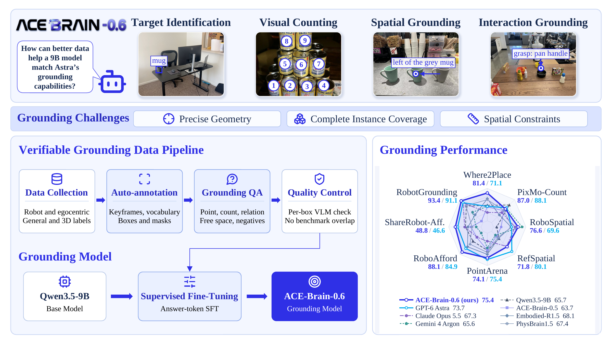
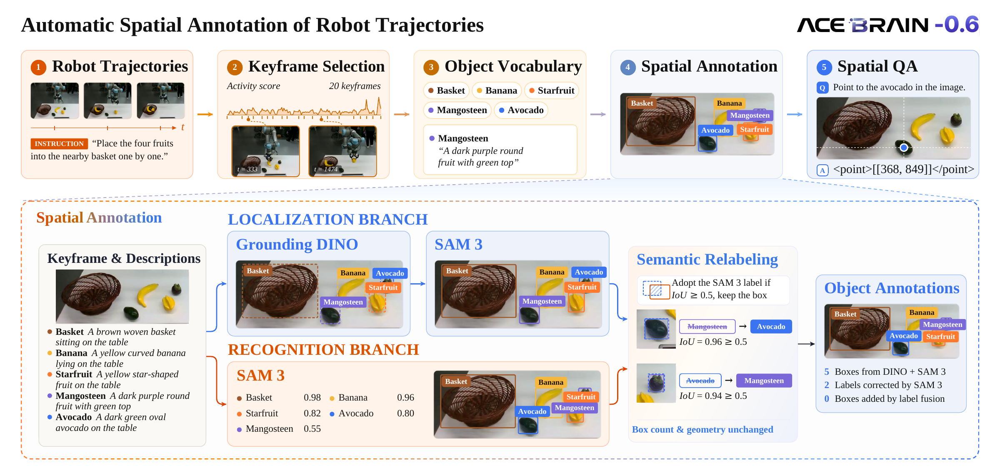
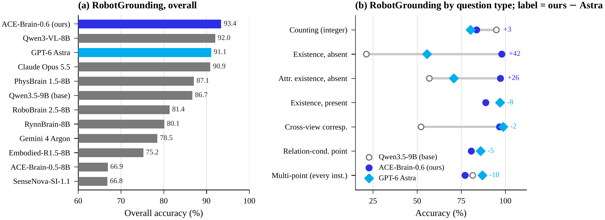
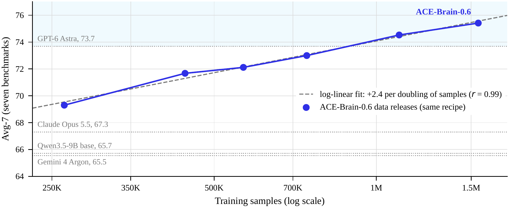

<div align="center">


# ACE-Brain-0.6: Scaling Spatial Grounding for Physical Foundation Models

<p>
  <a href="https://daxiaorobotics.github.io/ACE-Brain-0.6/"></a>
  <a href="https://arxiv.org/abs/2610.27040"></a>
  <a href="https://huggingface.co/ACERobotics/ACE-Brain-0.6-9B"></a>
  <a href="https://arxiv.org/pdf/2610.27040"></a>
  <a href="LICENSE"></a>
</p>

[Introduction](#introduction) · [Method](#method-architecture) · [Results](#performance-highlights) · [Tech Report](https://arxiv.org/pdf/2610.27040)

</div>

<p align="center">
  
</p>

## 📑 Contents

- [News](#news)
- [Introduction](#introduction)
- [Key Features](#key-features)
- [Method & Architecture](#method-architecture)
- [Performance Highlights](#performance-highlights)
- [Data Scaling](#data-scaling)
- [Citation](#citation)
- [Acknowledgements](#acknowledgements)
- [Contributors](#contributors)
- [Star History](#star-history)

---

<a id="news"></a>
## 🚀 News

- **ACE-Brain-0.6** introduces spatial grounding through diverse, verifiable supervision. Explore the model overview, annotation pipeline, and reported benchmark results below.
- The [technical report (PDF)](https://arxiv.org/pdf/2610.27040) and [Hugging Face model repository](https://huggingface.co/ACERobotics/ACE-Brain-0.6-9B) are available. Standalone inference code links are pending.

<a id="introduction"></a>
## 🧠 Introduction

**ACE-Brain-0.6** strengthens the spatial perception that connects language instructions to physical scenes. Given one or more images and a query, it identifies task-relevant objects, counts instances, resolves spatial relationships, and localizes interaction targets.

Built on **Qwen3.5-9B**, the model is fine-tuned on approximately **1.5 million samples** constructed from robot manipulation recordings, egocentric interactions, object and part annotations, and spatial data. A unified pipeline turns these sources into grounding answers that can be checked against their supporting annotations.

On seven public grounding benchmarks, ACE-Brain-0.6 achieves a reported **Avg-7 of 75.41**, compared with **65.72** for Qwen3.5-9B and **73.68** for GPT-6 Astra. It exceeds Astra on **four of seven** benchmarks, with remaining gaps on PixMo-Count, RefSpatial, and PointArena.

<a id="key-features"></a>
## 🔥 Key Features

- **🎯 Unified grounding interface.** Points, point lists, bounding boxes, counts, and categorical answers cover referring, spatial reasoning, interaction grounding, and absent-target recognition.
- **🦾 Robot-centered supervision.** Automatic annotation converts manipulation recordings into object-level grounding data, complemented by egocentric, general visual, and spatial sources.
- **🔎 Verifiable answers.** Quality checks verify object labels, require complete instance sets for counting, and check negative queries against image vocabularies.
- **📈 Scaling through broader coverage.** Larger and more diverse data releases improve grounding under a fixed backbone and training recipe.
- **🏆 Strong reported results.** A **+9.69-point Avg-7 gain** over the base model and **93.42** on RobotGrounding, the team's robot-scene evaluation set.

<a id="method-architecture"></a>
## 🏗️ Method & Architecture

ACE-Brain-0.6 uses **Qwen3.5-9B** as its vision-language backbone and casts grounding as conditional text generation. Training updates the language-model parameters, freezes the vision encoder, and uses answer-token supervision in non-thinking mode.

<p align="center">
  
</p>

The data pipeline has four steps:

1. **Collect diverse visual sources:** robot trajectories, egocentric interactions, object and part labels, and spatial annotations.
2. **Annotate robot scenes:** select keyframes, build scene-specific object vocabularies, localize objects with Grounding DINO and SAM 3, and reconcile their labels.
3. **Generate grounding questions:** cover referring, every-instance pointing, counting, spatial relations, free-space localization, interaction targets, and absent objects.
4. **Verify supervision:** check labels and answer consistency, balance answer forms, and exclude evaluation images and episodes from training.

| Task family | Output |
|:--|:--|
| Target identification | Point or bounding box |
| Multi-instance perception | List of points or integer count |
| Spatial grounding | Point or `yes` / `no` |
| Interaction grounding | Points for parts, contact regions, destinations, or trajectories |
| Absent-target recognition | `none` |
| Cross-view correspondence | Target location in another camera view |

Coordinates are integers normalized to **[0, 1000]** along each image axis. Free-space supervision identifies unoccupied **2D regions**; it does not by itself establish 3D placement feasibility.

<a id="performance-highlights"></a>
## 📊 Performance Highlights

The following results compare ACE-Brain-0.6 with GPT, Claude Opus, and Gemini models under the shared evaluation protocol in the [technical report](https://arxiv.org/pdf/2610.27040). Higher is better; bold marks the best score among the models shown.

| Benchmark | GPT-5.5 | GPT-5.6-sol | GPT-6 Astra | Claude Opus 5.5 | Gemini 4 Argon | ACE-Brain-0.6 |
|:--|--:|--:|--:|--:|--:|--:|
| Where2Place | 45.25 | 46.23 | 71.10 | 66.44 | 71.20 | **81.44** |
| PixMo-Count | 82.61 | 83.55 | **88.10** | 83.74 | 87.71 | 86.96 |
| RoboSpatial | 59.19 | 64.34 | 69.55 | 73.30 | **80.94** | 76.56 |
| RefSpatial | 60.29 | 54.51 | **80.14** | 71.10 | 51.56 | 71.84 |
| PointArena | 68.02 | 69.76 | **75.36** | 61.20 | 66.40 | 74.13 |
| RoboAfford | 68.04 | 71.45 | 84.94 | 75.10 | 71.48 | **88.14** |
| ShareRobot (affordance) | 38.57 | 36.66 | 46.60 | 40.20 | 29.53 | **48.82** |
| **Avg-7 · public benchmarks** | 60.28 | 60.93 | 73.68 | 67.30 | 65.55 | **75.41** |
| RobotGrounding · in-house benchmark | 83.96 | 85.18 | 91.10 | 90.89 | 78.51 | **93.42** |

**Avg-7** is the unweighted mean of the seven public benchmark scores. **RobotGrounding is evaluated separately and is not included in Avg-7.** It contains **2,591 questions** on held-out robot manipulation frames and reports a macro average over **14 scoring groups**.

<details>
<summary><b>Benchmark coverage and evaluation protocol</b></summary>

| Capability | Benchmarks |
|:--|:--|
| Constrained referring and reasoning | RefSpatial, PointArena |
| Multi-instance perception | PixMo-Count, PointArena counting |
| Spatial relations and free-space localization | RoboSpatial, Where2Place |
| Functional and interaction grounding | RoboAfford, ShareRobot affordance |
| Robot-scene grounding and cross-view correspondence | RobotGrounding |

All compared models use the same harness and benchmark-specific prompts, with temperature **0.2** and a **128-token** output budget. PixMo-Count uses **1,024 tokens** to accommodate lists of points. Each public benchmark uses its official metric.

</details>

<details>
<summary><b>RobotGrounding: overall results and capability breakdown</b></summary>

<p align="center">
  
</p>

The strongest gains over the base model appear in absent-object recognition, absent-attribute recognition, and cross-view correspondence. Astra retains advantages on every-instance pointing and relation-defined targets.

</details>

<a id="data-scaling"></a>
## 📈 Data Scaling

With the backbone and training recipe fixed, the reported Avg-7 rises from **69.3 to 75.4** as successive data releases grow from approximately **0.26M to 1.55M samples**.

<p align="center">
  
</p>

Each release expands both the number of samples and the coverage of supervision. The trend therefore reflects **data scale and diversity together**; a control that adds only more samples from existing sources improves the average by less than one point.

<a id="citation"></a>
## 📖 Citation

If you find ACE-Brain-0.6 useful, please cite our [arXiv paper](https://arxiv.org/abs/2610.27040):

```bibtex
@misc{wang2026acebrain06scalingspatialgrounding,
      title={ACE-Brain-0.6: Scaling Spatial Grounding for Physical Foundation Models},
      author={Yinhe Wang and Tao Tao and Zexin He and Shuang Luo and Wei Mao and Yao Mu and
              Feng Pan and Hanming Deng and Lewei Lu and Zhi Hou and Xingang Pan and Dahua Lin and
              Dacheng Tao and Xiaogang Wang},
      year={2026},
      eprint={2610.27040},
      archivePrefix={arXiv},
      primaryClass={cs.RO},
      url={https://arxiv.org/abs/2610.27040},
}
```

<a id="acknowledgements"></a>
## 🙏 Acknowledgements

ACE-Brain-0.6 builds on Qwen3.5-9B and uses [Grounding DINO](https://github.com/IDEA-Research/GroundingDINO) and [SAM 3](https://github.com/facebookresearch/sam3) in its annotation pipeline. We thank the creators of the robot, egocentric, grounding, and spatial datasets and the benchmark authors whose work supports this research.

This project continues the [ACE-Brain](https://github.com/DAXIAORobotics/ACE-Brain-0) research line.

<a id="contributors"></a>
## 👥 Contributors

**Contributors:** Yinhe Wang, Tao Tao, Zexin He, Shuang Luo, Wei Mao, Feng Pan, Hanming Deng, and Lewei Lu.

**Advisors:** Zhi Hou, Xingang Pan, Dahua Lin, Dacheng Tao, and Xiaogang Wang.

<a id="star-history"></a>
## ⭐ Star History

<details>
<summary><b>View the repository's star history</b></summary>

<a href="https://www.star-history.com/#DAXIAORobotics/ACE-Brain-0.6&type=date">
  
</a>

</details>
